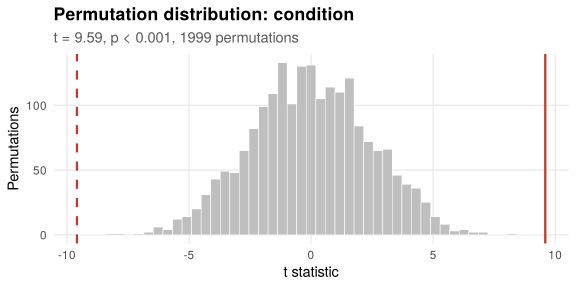
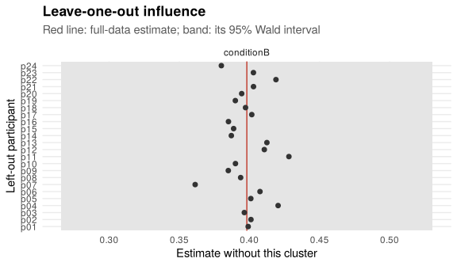

*This vignette is precomputed: the results shown were obtained with the code
displayed, which takes a few minutes to run.*

`lmmresample` gives permutation tests and bootstrap confidence intervals for
mixed models (`lme4::lmer()`) and linear models (`lm()`) fitted to repeated
measurements organised in blocks: samples within trials, trials within
participants. Resampling always moves whole blocks and refits the model you
already have, so the dependence within blocks is carried into the reference
distribution instead of having to be modelled.

This vignette works through a trial-level analysis: one value per trial, two
conditions, every participant seeing both. The vignette
`vignette("time-courses")` covers full time series, and
`vignette("multiple-comparisons")` covers families of tests and pairwise
comparisons.


```r
library(lmmresample)
library(lme4)
```

## Example data

`sim_blocks()` simulates block-structured data with known effects. Here, 24
participants complete 40 trials each in conditions A and B; condition B
increases the outcome by 0.3 on average, and participants differ in the size
of that effect (`sd_slope`).


```r
d <- sim_blocks("within", level = "trial", n_participants = 24, n_trials = 40,
                effect_condition = 0.3, sd_slope = 0.4, seed = 1)
head(d[c("participant", "trial", "trial_index", "condition", "y")])
#>   participant   trial trial_index condition            y
#> 1         p01 p01_t01           1         A -0.123122022
#> 2         p01 p01_t02           2         B  0.310535946
#> 3         p01 p01_t03           3         B -0.925765442
#> 4         p01 p01_t04           4         B -0.304508300
#> 5         p01 p01_t05           5         B -0.005405251
#> 6         p01 p01_t06           6         B  1.540625229
```

## Why Wald tests can mislead

A common analysis fits a random intercept for each participant and reads the
Wald (t) test of the condition coefficient:


```r
m <- lmer(y ~ condition + (1 | participant), data = d)
summary(m)$coefficients
#>              Estimate Std. Error  t value
#> (Intercept) 0.7194377 0.19870672 3.620601
#> conditionB  0.3982002 0.04152217 9.590063
```

The standard error assumes that the condition effect is the same in every
participant. Because it is not, the 960 trials carry much less independent
information about the mean effect than the model assumes, and the test is
too liberal. Adding a random slope (the maximal model) fixes this here, but in
richer designs the maximal model often fails to converge or is singular, and
in time-series data even the maximal model is not enough (see
`vignette("time-courses")`).

## A permutation test on the same model

`perm_test()` keeps the model as it is and builds the null distribution of the
statistic by resampling. Two arguments describe the design:

* `unit`: the column identifying what is permuted, here the trial;
* `exchange`: which units may be exchanged. `exch_signflip("participant")`
  swaps the condition labels of all trials of a random subset of participants,
  which reverses their individual effects. This tests whether the *mean*
  effect is zero while allowing participants to differ in their effect.


```r
pt <- perm_test(m, "condition", unit = "trial",
                exchange = exch_signflip("participant"), B = 1999, seed = 1)
pt
#> 
#> Permutation test for `condition` (coefficient `conditionB`)
#> 
#> Method:    relabelling of units
#> Exchange:  labels of `trial` swapped (sign-flipped) by `participant` (960 units in 24 blocks)
#> Statistic: t = 9.590
#> p-value:   < 0.001 (two-sided)
#> Resamples: 1999 of 1999 permutations used
```


```r
plot(pt)
```



The other exchangeability declarations are `exch_within("participant")`,
which permutes trials within participants and tests the sharp null of no
effect in anyone, and `exch_free()`, which permutes freely and suits
between-group designs (e.g. `unit = "participant"` with group membership as
the tested term). `exch_free(strata = "site")` restricts permutation to
within strata.

The test refits the full model for every permutation, so it can take some
time with large data sets. Computation runs in parallel through the
[future](https://future.futureverse.org/) framework:


```r
future::plan("multisession", workers = 4)
```

Results are reproducible for a given `seed` whatever the number of workers.

## Bootstrap confidence intervals

`boot_ci()` resamples whole participants (case bootstrap) and refits the model
to each resample. The default interval is the *expanded* percentile interval,
which corrects the percentile interval for the small number of participants
typical of experimental studies. Here it is computed for the maximal model:


```r
mf <- lmer(y ~ condition + (1 + condition | participant), data = d)
b <- boot_ci(mf, cluster = "participant", B = 1999, seed = 1)
b
#> 
#> Bootstrap confidence intervals (case bootstrap of `participant`, 24 clusters)
#> 
#> 95% expanded percentile intervals
#>  Coefficient Estimate Lower Upper
#>  conditionB  0.398    0.262 0.538
#> 
#> Replicates: 1999 of 1999 used
```

Other intervals are available through `ci` (`"percentile"`, `"bca"`,
`"basic"`), and `resample = "wild"` gives a wild bootstrap of participants.
With groups of participants (a between-group design), `strata = "group"` keeps
the size of each group fixed in every resample.

## Adjusting for covariates

When the model contains other terms, such as trial order, the tested term is
permuted through the residuals of the reduced model (the Freedman-Lane
procedure), which keeps the covariate effects in place. `method = "auto"`, the
default, chooses this automatically:


```r
d$order <- as.numeric(scale(d$trial_index))
m_order <- lmer(y ~ condition + order + (1 | participant), data = d)
pt_order <- perm_test(m_order, "condition", unit = "trial",
                      exchange = exch_signflip("participant"),
                      B = 1999, seed = 1)
pt_order
#> 
#> Permutation test for `condition` (coefficient `conditionB`)
#> 
#> Method:    relabelling of units
#> Exchange:  labels of `trial` swapped (sign-flipped) by `participant` (960 units in 24 blocks)
#> Statistic: t = 9.633
#> p-value:   < 0.001 (two-sided)
#> Resamples: 1999 of 1999 permutations used
```

## Diagnostics

Two quick checks help interpret a result. `diag_agreement()` compares the
model coefficient with the mean of the participant-level differences; a large
discrepancy suggests that the model weights participants in an unexpected way
or that a confound is at work:


```r
diag_agreement(m, "condition", cluster = "participant")
#> 
#> Agreement for `condition` (B - A)
#> 
#> Model coefficient:              0.398
#> Mean participant-level difference: 0.398 (SE 0.068, 24 participants)
#> Discrepancy:                    0.000 (0%)
#> 
#> The model coefficient agrees with the participant-level differences.
```

`diag_loso()` refits the model leaving out one participant at a time and
reports how much each participant moves the estimate:


```r
lo <- diag_loso(mf, cluster = "participant")
lo
#> 
#> Leave-one-participant-out influence (24 refits)
#> 
#>  Coefficient Estimate Range          Most influential
#>  conditionB  0.398    0.361 to 0.428 p07 (-0.55 SE)
```


```r
plot(lo)
```



## Checking the test for your design

`perm_calibrate()` simulates data from the fitted model with the effect
removed and reports how often the permutation and Wald tests reject at the 5%
level. It checks that the chosen exchangeability gives a valid test for a
given design:


```r
cal <- perm_calibrate(m, "condition", unit = "trial",
                      exchange = exch_signflip("participant"),
                      n_sim = 100, B = 99, seed = 1)
cal
#> 
#> Calibration of the permutation test for `condition`
#> 
#> Null:        mean effect zero, participant variation kept
#> Residuals:   independent
#> Exchange:    labels of `trial` swapped (sign-flipped) by `participant`
#> Simulations: 100, with 99 permutations each
#> 
#> Rejection rate at alpha = 0.05:
#>   Permutation  0.050  [0.016, 0.113]  consistent with alpha
#>   Wald         0.030  [0.006, 0.085]  consistent with alpha
#> 
#> Uniformity of permutation p-values (Kolmogorov-Smirnov): p = 0.178
```

Both tests hold the nominal level here. The simulated data reproduce the
structure of the fitted model, which has independent residuals and no
participant variation in the effect, and under that structure the Wald test
is valid too. The calibration reflects only the dependence included in the
simulation: for time series, `ar1` adds the autocorrelation of the residuals,
and `vignette("time-courses")` shows how differently the two tests then
behave.

## Reporting

Every result has a `tidy()` method returning a data frame, convenient for
tables:


```r
tidy(pt)
#>        term       coef statistic df p.value alternative    B B_used
#> 1 condition conditionB  9.590063  1   5e-04   two.sided 1999   1999
#>                  method
#> 1 permutation (relabel)
tidy(b)
#>         term  estimate  conf.low conf.high     type level
#> 1 conditionB 0.3982002 0.2622967 0.5376454 expanded  0.95
```

For reporting, use at least the default number of resamples (`B = 4999`).
