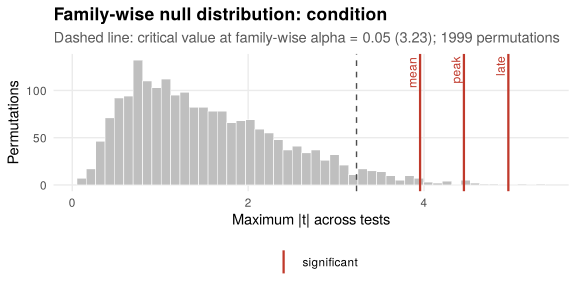

*This vignette is precomputed: the results shown were obtained with the code
displayed, which takes a few minutes to run.*

Analyses of physiological signals rarely end with a single test. Several
features are often extracted from the same trials (mean, peak, late
response), and factors often have more than two levels, which calls for
pairwise comparisons. This vignette shows how `lmmresample` controls the
family-wise error rate in both situations while keeping the power that
corrections such as Bonferroni or Holm give away.


```r
library(lmmresample)
library(lme4)
```

## Several features from the same trials

We simulate time series and extract three features per trial: the mean over
the whole trial, the peak, and the mean of the late window (from 1 s).


```r
ts <- sim_blocks("within", level = "timeseries", n_participants = 20,
                 n_trials = 30, n_time = 50, sampling_rate = 25,
                 effect_condition = 0.3, effect_onset = 0.5, sd_slope = 0.3,
                 ar1 = 0.9, seed = 3)
feat <- aggregate(y ~ participant + trial + condition, ts, mean)
names(feat)[names(feat) == "y"] <- "mean"
feat$peak <- aggregate(y ~ participant + trial + condition, ts, max)$y
feat$late <- aggregate(y ~ participant + trial + condition,
                       ts[ts$time >= 1, ], mean)$y
head(feat)
#>   participant   trial condition       mean        peak       late
#> 1         p01 p01_t01         A  0.1159974  1.79451310  0.2730235
#> 2         p01 p01_t02         A -1.0140783 -0.04281802 -1.2378820
#> 3         p01 p01_t03         A -1.9399087 -0.07689758 -1.9605965
#> 4         p01 p01_t08         A -0.3624909  1.35299691 -0.2773798
#> 5         p01 p01_t09         A  0.6104789  2.97043862  0.3173673
#> 6         p01 p01_t10         A  1.5867119  2.66694798  1.7880359
```

One model per feature:


```r
m_mean <- lmer(mean ~ condition + (1 | participant), data = feat)
m_peak <- lmer(peak ~ condition + (1 | participant), data = feat)
m_late <- lmer(late ~ condition + (1 | participant), data = feat)
```

The features are computed from the same trials, so they are correlated.
`perm_maxt()` permutes all models together, with the same permutation of
trials for every feature, and compares each observed statistic with the
distribution of the *largest* statistic across the family. This controls the
family-wise error rate and, unlike Bonferroni or Holm, takes the correlation
between features into account: the more similar the features, the smaller the
penalty.


```r
fam <- perm_maxt(mean = perm_spec(m_mean, "condition"),
                 peak = perm_spec(m_peak, "condition"),
                 late = perm_spec(m_late, "condition"),
                 unit = "trial", exchange = exch_signflip("participant"),
                 B = 1999, seed = 1)
fam
#> 
#> Family-wise permutation tests for `condition` (max-t, step-down)
#> 
#> Method:    relabelling of units
#> Exchange:  labels of `trial` swapped (sign-flipped) by `participant` (600 units in 20 blocks)
#> Resamples: 1999 of 1999 permutations used
#> 
#>  Test Statistic   p (unadjusted) p (family-wise)
#>  mean |t| = 3.955 0.002          0.002          
#>  peak |t| = 4.453 0.001          0.002          
#>  late |t| = 4.959 0.002          0.002
```


```r
plot(fam)
```



The step-down version (the default) is uniformly more powerful than the
single-step one and controls the same error rate. `combine = "min-p"` uses
p-values instead of statistics, which is preferable when the statistics are
on different scales, for instance when combining tests with different numbers
of coefficients. The same function combines terms of one model, such as the
terms of a growth curve analysis:


```r
perm_maxt(level = perm_spec(m_gca, "condition"),
          linear = perm_spec(m_gca, "ot1:condition"),
          quadratic = perm_spec(m_gca, "ot2:condition"),
          unit = "trial", exchange = exch_signflip("participant"))
```

## Pairwise comparisons between levels of a factor

With a factor of more than two levels, a significant omnibus test is usually
followed by pairwise comparisons. `perm_pairwise()` tests every pair by
permutation, adjusts the p-values across pairs and, optionally, gives
bootstrap intervals for each difference.

Here, stimuli of three types are presented, and only the negative stimuli
increase the response. Trial order is included as a covariate.


```r
d <- sim_blocks("within", level = "trial", n_participants = 24, n_trials = 48,
                seed = 4)
d$condition <- NULL
set.seed(4)
d$stimulus <- factor(sample(c("neutral", "positive", "negative"), nrow(d),
                            replace = TRUE),
                     levels = c("neutral", "positive", "negative"))
d$y <- d$y + 0.3 * (d$stimulus == "negative")
d$order <- as.numeric(scale(d$trial_index))
m <- lmer(y ~ stimulus + order + (1 | participant), data = d)
```


```r
pw <- perm_pairwise(m, "stimulus", unit = "trial",
                    exchange = exch_signflip("participant"),
                    cluster = "participant", B = 1999, seed = 1)
pw
#> 
#> Pairwise permutation tests of `stimulus` between levels of `stimulus`
#> 
#> Method:     Freedman-Lane (residuals of the reduced model)
#> Exchange:   labels of `trial` swapped (sign-flipped) by `participant` (1152 units in 24 blocks)
#> Adjustment: Westfall-Young max-t, step-down
#> Resamples:  1999 of 1999 permutations used
#> 
#>  Comparison          Estimate 95% CI          Statistic   p (unadjusted)
#>  positive - neutral  -0.047   [-0.147, 0.041] |t| = 1.034 0.291         
#>  negative - neutral  0.256    [0.159, 0.349]  |t| = 5.629 < 0.001       
#>  negative - positive 0.303    [0.215, 0.382]  |t| = 6.583 < 0.001       
#>  p (adjusted)
#>  0.291       
#>  < 0.001     
#>  < 0.001     
#> 
#> Intervals: expanded percentile bootstrap, not adjusted for multiplicity.
```

Each pair is tested with the other levels and the covariates kept in the
model (a Freedman-Lane test in a reparametrised model), so a difference
between two levels does not leak into the comparison of the other two. This
keeps the error rate under control even when some levels differ and others
do not. The default adjustment, Westfall-Young, is the max-t procedure across
pairs; `adjust = "holm"` and `adjust = "none"` are also available.

`cluster = "participant"` adds bootstrap intervals of each difference, which
take the participant structure into account. `tidy()` returns everything as a
data frame:


```r
tidy(pw)
#>            comparison reference    level    estimate stat statistic p.value
#> 1  positive - neutral   neutral positive -0.04738957  |t|  1.033848  0.2910
#> 2  negative - neutral   neutral negative  0.25581385  |t|  5.629209  0.0005
#> 3 negative - positive  positive negative  0.30320342  |t|  6.582779  0.0005
#>   p.adjusted   conf.low  conf.high         adjust
#> 1     0.2910 -0.1466948 0.04072638 westfall-young
#> 2     0.0005  0.1593071 0.34932389 westfall-young
#> 3     0.0005  0.2149402 0.38227683 westfall-young
```

### Pairwise comparisons of time courses

For time-series models, `term` names the interaction to compare, and `time`
identifies the samples within trials, exactly as in `perm_test()`:


```r
library(splines)
mt <- lmer(y ~ stimulus * ns(time, 4) + (1 | participant), data = d_timeseries)
perm_pairwise(mt, "stimulus", term = "stimulus:ns(time, 4)",
              unit = "trial", exchange = exch_signflip("participant"),
              time = "time")
```

In simulations, pairwise Wald tests of time-course models with Holm's
correction declared a false difference in about 80% of data sets, whereas
`perm_pairwise()` kept the family-wise error rate at 5%.
