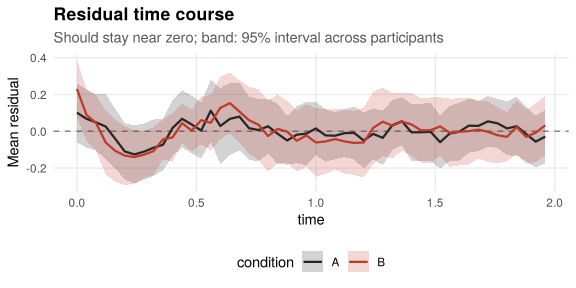
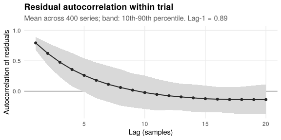
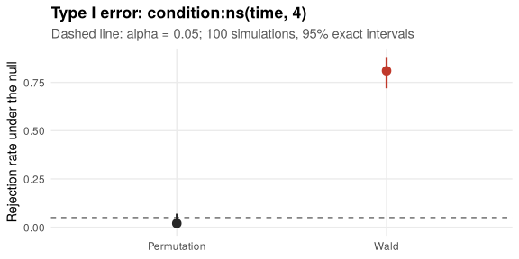

*This vignette is precomputed: the results shown were obtained with the code
displayed, which takes about half an hour to run on one core.*

Physiological signals such as pupil size, EEG or skin conductance are sampled
many times per trial, and consecutive samples are strongly correlated. A
mixed model of the full time series, with the condition effect allowed to
change over time, describes the data well, but its Wald and Satterthwaite
tests treat the samples as nearly independent and are far too liberal. In
simulations with realistic autocorrelation they declared about half of
truly null condition × time effects significant.

`lmmresample` keeps the model and replaces only the inference: whole trials
are permuted or whole participants resampled, so the autocorrelation within
trials is carried into the reference distribution.


```r
library(lmmresample)
library(lme4)
library(splines)
```

## Example data

Twenty participants complete 20 trials in each of two conditions; each trial
has 50 samples over two seconds, with strongly autocorrelated noise (AR(1)
coefficient 0.9). The response in condition B rises above condition A from
0.5 s.


```r
d <- sim_blocks("within", level = "timeseries", n_participants = 20,
                n_trials = 20, n_time = 50, sampling_rate = 25,
                effect_condition = 0.6, effect_onset = 0.5, sd_slope = 0.3,
                ar1 = 0.9, seed = 2)
head(d[c("participant", "trial", "condition", "time", "y")])
#>   participant   trial condition time         y
#> 1         p01 p01_t01         A 0.00 -4.297099
#> 2         p01 p01_t01         A 0.04 -4.604019
#> 3         p01 p01_t01         A 0.08 -4.500372
#> 4         p01 p01_t01         A 0.12 -3.683364
#> 5         p01 p01_t01         A 0.16 -3.567343
#> 6         p01 p01_t01         A 0.20 -3.947271
```

## The model

The time course is described with a natural spline of time, and its
interaction with condition captures how the condition difference changes over
the trial:


```r
m3 <- lmer(y ~ condition * ns(time, 3) + (1 | participant), data = d)
```

### Is the time course described adequately?

`diag_timecourse()` averages the residuals over time in each condition. If the
model captures the shape of the response and of the condition difference, the
mean residual stays near zero; it is flagged when the largest standardised
mean residual exceeds a Bonferroni threshold.


```r
diag_timecourse(m3, "time", by = "condition", cluster = "participant")
#> 
#> Residual time course over `time` by `condition`
#> 
#> Largest |mean residual / SE| (Bonferroni threshold 3.48 over 100 points):
#>   A            2.22   (largest mean residual 0.16 residual SD)
#>   B            4.61   (largest mean residual 0.32 residual SD)
#> 
#> The mean residual departs from zero over time: consider flexible time terms
#> (e.g. splines::ns(time, 4)) and their interaction with the condition.
```

The sharp onset in condition B is not captured by three degrees of freedom.
With four, the departure disappears:


```r
m <- lmer(y ~ condition * ns(time, 4) + (1 | participant), data = d)
tc <- diag_timecourse(m, "time", by = "condition", cluster = "participant")
tc
#> 
#> Residual time course over `time` by `condition`
#> 
#> Largest |mean residual / SE| (Bonferroni threshold 3.48 over 100 points):
#>   A            1.57   (largest mean residual 0.11 residual SD)
#>   B            2.89   (largest mean residual 0.20 residual SD)
#> 
#> No systematic departure of the mean residual from zero.
```


```r
plot(tc)
```



A misspecified time course does not invalidate the permutation test, but the
coefficients then answer a different question and power is lost.

### How strong is the autocorrelation?


```r
ac <- diag_acf(m, series = "trial", time = "time")
ac
#> 
#> Residual autocorrelation within `trial` (ordered by `time`)
#> 
#> Series:            400 (median length 50)
#> AR(1) coefficient: 0.895 (bias-corrected; uncorrected lag-1 mean 0.794)
#> Mean autocorrelation at lags 1, 2, 5, 10, 20: 0.79, 0.62, 0.26, -0.02, -0.14
#> 
#> Residuals are strongly autocorrelated: Wald tests that treat samples as
#> independent are unreliable. Resample whole series (see perm_test()).
```


```r
plot(ac)
```



## Testing the condition × time interaction

The interaction has four coefficients, tested jointly. Because the model
contains other terms that depend on time, the residuals of the reduced model
(without the interaction) are permuted between trials (Freedman-Lane); `time`
tells the function how to match samples within trials. With
`exch_signflip("participant")`, the condition labels of all trials of a random
subset of participants are swapped, which tests the mean effect while letting
participants differ in theirs.


```r
pt <- perm_test(m, "condition:ns(time, 4)", unit = "trial",
                exchange = exch_signflip("participant"), time = "time",
                B = 1999, seed = 1)
pt
#> 
#> Permutation test for `condition:ns(time, 4)` (4 coefficients)
#> 
#> Method:    Freedman-Lane (residuals of the reduced model)
#> Exchange:  labels of `trial` swapped (sign-flipped) by `participant` (400 units in 20 blocks)
#> Statistic: chi2(4) = 173.867
#> p-value:   0.001 (joint test)
#> Resamples: 1999 of 1999 permutations used
```

For comparison, the Wald test of the same four coefficients:


```r
cf <- grep("^conditionB:", names(fixef(m)), value = TRUE)
b <- fixef(m)[cf]
V <- as.matrix(vcov(m))[cf, cf]
stats::pchisq(drop(b %*% solve(V, b)), df = length(cf), lower.tail = FALSE)
#> [1] 1.546596e-36
```

Both tests detect this effect, which is large. The difference lies in what
happens when there is no effect, which the next section checks.

## Checking validity on your own data

`perm_calibrate()` simulates new data from the fitted model with the tested
effect removed, adds residuals with the autocorrelation estimated by
`diag_acf()`, and counts how often each test rejects at the 5% level.


```r
cal <- perm_calibrate(m, "condition:ns(time, 4)", unit = "trial",
                      exchange = exch_signflip("participant"), ar1 = ac,
                      series = "trial", time = "time",
                      n_sim = 100, B = 99, seed = 1)
cal
#> 
#> Calibration of the permutation test for `condition:ns(time, 4)`
#> 
#> Null:        mean effect zero, participant variation kept
#> Residuals:   AR(1), phi = 0.895 within `trial`
#> Exchange:    labels of `trial` swapped (sign-flipped) by `participant`
#> Simulations: 100, with 99 permutations each
#> 
#> Rejection rate at alpha = 0.05:
#>   Permutation  0.020  [0.002, 0.070]  consistent with alpha
#>   Wald         0.810  [0.719, 0.882]  liberal (too many rejections)
#> 
#> Uniformity of permutation p-values (Kolmogorov-Smirnov): p = 0.864
```


```r
plot(cal, type = "rejection")
```



The Wald test rejects a true null hypothesis most of the time, whereas the
permutation test stays at the nominal level. Running `perm_calibrate()` before
interpreting a result shows whether this applies to a given design.

## Confidence intervals for the time course

`boot_ci()` resamples whole participants, so the intervals account for the
dependence between samples. `terms` restricts the output to the coefficients
of interest:


```r
bt <- boot_ci(m, cluster = "participant", terms = cf, B = 1999, seed = 1)
bt
#> 
#> Bootstrap confidence intervals (case bootstrap of `participant`, 20 clusters)
#> 
#> 95% expanded percentile intervals
#>  Coefficient             Estimate Lower Upper
#>  conditionB:ns(time, 4)1 0.821    0.458 1.163
#>  conditionB:ns(time, 4)2 0.433    0.033 0.795
#>  conditionB:ns(time, 4)3 0.948    0.440 1.405
#>  conditionB:ns(time, 4)4 0.500    0.261 0.729
#> 
#> Replicates: 1999 of 1999 used
```

The Wald intervals of the same coefficients are much narrower than they should
be:


```r
se <- sqrt(diag(V))
cbind(estimate = b, lower = b - 1.96 * se, upper = b + 1.96 * se)
#>                          estimate     lower     upper
#> conditionB:ns(time, 4)1 0.8207712 0.6643335 0.9772089
#> conditionB:ns(time, 4)2 0.4331304 0.2791385 0.5871223
#> conditionB:ns(time, 4)3 0.9477954 0.6421340 1.2534568
#> conditionB:ns(time, 4)4 0.4998000 0.3569659 0.6426342
```

## Group × condition × time

With two groups of participants (`sim_blocks("mixed")`), the question is often
whether the condition effect over time differs between groups. The term
`group:condition:ns(time, 4)` is tested in the same way, with
`exch_signflip("participant")` as before, and `boot_ci()` takes
`strata = "group"` so that each bootstrap resample keeps the size of each
group:


```r
mt <- lmer(y ~ group * condition * ns(time, 4) + (1 | participant),
           data = d_mixed)
perm_test(mt, "group:condition:ns(time, 4)", unit = "trial",
          exchange = exch_signflip("participant"), time = "time")
boot_ci(mt, cluster = "participant", strata = "group",
        terms = grep("^group.*:condition.*:ns", names(fixef(mt)),
                     value = TRUE))
```

## Practical notes

* The intercept-only model is usually enough for the permutation test of a
  time-course term: validity does not depend on the random-effects structure,
  and the model is fast to fit and rarely singular.
* Computation time grows with the number of rows and with `B`. Running in
  parallel with `future::plan("multisession", workers = ...)` divides it by
  roughly the number of workers.
* Aggregating to fewer time points (e.g. 20 to 50 per trial) speeds up every
  refit and changes the results very little when the signal is smooth.
